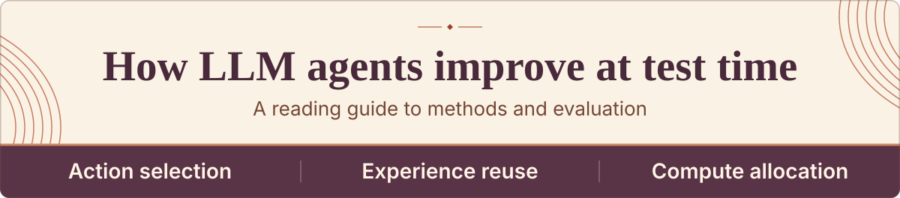

# Awesome Agent Test-Time Improvement

  

> [!NOTE]
> **Survey paper** · [PDF](main.pdf)
>
> *A Survey of LLM Agents for Test-Time Improvements*

---

### ✨ Overview

When a test fails, a coding agent can use the result to revise its patch. It can also keep a record of the failure for future tasks. The time and compute left for the repair matter when deciding whether to run another test. The reading list covers these three decisions under **decision-time improvement**, **experience-based adaptation**, and **adaptive resource allocation**.

Browse **191 papers and surveys** by topic. The [evidence register](evidence_matrix.csv) covers 190 of them. The list also includes a survey of autonomous agents cited in the introduction. Paper links lead to the published version where available, or to the arXiv revision checked for this update. The register records the version and location used to extract each result. [Survey map](assets/survey-overview.png)

> [!IMPORTANT]
> **Suggest a paper or a correction**
>
> Open an issue or pull request with the paper link, its topic, and one sentence about the mechanism it studies. For a code entry, include the authors’ repository.

---

### 📚 Contents

- [🧭 Decision-time improvement](#decisions)
  - [Evaluation and selection (15)](#selection)
  - [Feedback-guided revision (9)](#revision)
  - [Search and exploration (20)](#search)
  - [Model-based lookahead (7)](#lookahead)
- [🧠 Experience-based adaptation](#adaptation)
  - [Building memory (8)](#memory)
  - [Retrieving and using experience (9)](#retrieval)
  - [Skills and procedures (5)](#skills)
  - [Updating models and learning update rules (20)](#updates)
- [🎛️ Adaptive resource allocation](#control)
  - [Scheduling deliberation and interaction (3)](#timing)
  - [Allocating extra work (8)](#allocation)
  - [Model routing and collaboration (7)](#routing)
  - [Retrying and stopping (1)](#stopping)
- [📏 Evaluation protocols](#evaluation)
  - [Search, compute, and interaction budgets (6)](#evaluation-search)
  - [Verification and feedback reliability (8)](#evaluation-verification)
  - [Memory, transfer, and task streams (9)](#evaluation-memory)
- [📖 Training and foundations](#background)
  - [Agent training and system design (13)](#training)
  - [Training signals and reward design (13)](#rewards)
  - [Foundations and comparison methods (18)](#foundations)
- [📚 Related surveys](#surveys)
  - [Survey papers (12)](#survey-papers)

---

### 🧭 Decision-time improvement

How can an agent choose a better action with the evidence it can obtain now? Chapter 3 compares four ways of working on the current decision.

#### Evaluation and selection (15)

| Title | Venue | Year | Description | Code |
| :--- | :---: | :---: | :--- | :--- |
| **[Agentic Reward Modeling: Verifying GUI Agent via Progressive Trajectory-Grounded Interaction](https://arxiv.org/abs/2602.00575v2)** | arXiv | 2026 | Probes a GUI to check behavior against the observed trajectory. | — |
| **[Agentic Rubrics as Contextual Verifiers for SWE Agents](https://aclanthology.org/2026.acl-long.697/)** | ACL | 2026 | Derives repository-specific criteria for evaluating candidate patches. | — |
| **[Compare to Correct: Pairwise-Guided Logit Adjustment for LLM Test-Time Scaling](https://arxiv.org/abs/2610.18583v1)** | arXiv | 2026 | Compares the confidence of reasoning paths that support different answers and adjusts the vote scores before selection. | — |
| **[AgentV-RL: Scaling Reward Modeling with Agentic Verifier](https://aclanthology.org/2026.findings-acl.1156/)** | Findings of ACL | 2026 | Uses an agentic verifier to obtain evidence for reward judgments. | — |
| **[KV-PRM: Efficient Process Reward Modeling via KV-Cache Transfer for Multi-Agent Test-Time Scaling](https://arxiv.org/abs/2607.09153v2)** | arXiv | 2026 | Transfers KV caches to reduce the cost of process reward scoring. | — |
| **[LLM-as-a-Verifier: A General-Purpose Verification Framework](https://arxiv.org/abs/2607.05391v2)** | arXiv | 2026 | Splits criteria into individual checks and combines repeated judgments. | — |
| **[ToolPRM: Fine-Grained Inference Scaling of Structured Outputs for Function Calling](https://aclanthology.org/2026.acl-long.855/)** | ACL | 2026 | Scores the structure and arguments of candidate tool calls. | — |
| **[AgentPRM: Process Reward Models for LLM Agents via Step-Wise Promise and Progress](https://doi.org/10.1145/3774904.3792551)** | The Web Conference | 2026 | Combines expected success with the relative progress made by a step. | — |
| **[MASPRM: Multi-Agent System Process Reward Model](https://arxiv.org/abs/2510.24803v3)** | arXiv | 2026 | Studies process rewards for judging intermediate steps in multi-agent systems. | — |
| **[AgentRM: Enhancing Agent Generalization with Reward Modeling](https://aclanthology.org/2025.acl-long.945/)** | ACL | 2025 | Uses rewards or model judgments to select candidates and guide expansion. | — |
| **[Process Reward Models for LLM Agents: Practical Framework and Directions](https://arxiv.org/abs/2502.10325v1)** | arXiv | 2025 | Estimates action values from sampled continuations to rank candidates. | — |
| **[RoboMonkey: Scaling Test-Time Sampling and Verification for Vision-Language-Action Models](https://proceedings.mlr.press/v305/kwok25a.html)** | CoRL | 2025 | Combines sampling with verification for vision-language-action policies. | — |
| **[RoVer: Robot Reward Model as Test-Time Verifier for Vision-Language-Action Model](https://arxiv.org/abs/2510.10975v2)** | arXiv | 2025 | Uses a robot reward model to verify candidate actions at test time. | — |
| **[Web-Shepherd: Advancing PRMs for Reinforcing Web Agents](https://doi.org/10.52202/085713-2127)** | NeurIPS | 2025 | Checks web trajectories against task-specific requirements. | — |
| **[Enhancing Decision-Making for LLM Agents via Step-Level Q-Value Models](https://doi.org/10.1609/aaai.v39i25.34924)** | AAAI | 2025 | Estimates action values at individual steps of an agent trajectory. | — |

#### Feedback-guided revision (9)

| Title | Venue | Year | Description | Code |
| :--- | :---: | :---: | :--- | :--- |
| **[CURE: Critique-Driven Unified Reinforcement Learning for Test-Time Self-Improvement](https://aclanthology.org/2026.acl-long.1321/)** | ACL | 2026 | Uses critiques to improve reasoning and compares token use with latency. | — |
| **[Inference-Time Scaling of Verification: Self-Evolving Deep Research Agents via Test-Time Rubric-Guided Verification](https://aclanthology.org/2026.findings-acl.1243/)** | Findings of ACL | 2026 | Uses rubric-level diagnoses to revise a research answer. | — |
| **[GenPilot: A Multi-Agent System for Test-Time Prompt Optimization in Image Generation](https://aclanthology.org/2025.findings-emnlp.49/)** | Findings of EMNLP | 2025 | Revises image-generation prompts using errors observed in earlier outputs. | — |
| **[Mapping Smarter, Not Harder: A Test-Time Reinforcement Learning Agent That Improve Without Labels or Model Updates](https://aclanthology.org/2025.emnlp-industry.75/)** | EMNLP (Industry Track) | 2025 | Searches for evidence about ambiguous schema fields before revising a mapping. | — |
| **[Planning without Search: Refining Frontier LLMs with Offline Goal-Conditioned RL](https://proceedings.neurips.cc/paper_files/paper/2025/hash/0e87f947391341256517bdc5d206e539-Abstract-Conference.html)** | NeurIPS | 2025 | Grounds natural-language critiques in learned value estimates to guide revision. | — |
| **[S2R: Teaching LLMs to Self-verify and Self-correct via Reinforcement Learning](https://aclanthology.org/2025.acl-long.1104/)** | ACL | 2025 | Trains language models to verify and correct their own answers. | — |
| **[Two Heads Are Better Than One: Dual-Model Verbal Reflection at Inference-Time](https://aclanthology.org/2025.emnlp-main.155/)** | EMNLP | 2025 | Uses two models for verbal reflection at inference time. | — |
| **[When Agents go Astray: Course-Correcting SWE Agents with PRMs](https://arxiv.org/abs/2509.02360v2)** | arXiv | 2025 | Detects unproductive steps in software repair trajectories to redirect exploration. | — |
| **[Reflexion: language agents with verbal reinforcement learning](https://proceedings.neurips.cc/paper_files/paper/2023/hash/1b44b878bb782e6954cd888628510e90-Abstract-Conference.html)** | NeurIPS | 2023 | Turns an unsuccessful attempt into a verbal reflection that can guide a retry. | [GitHub](https://github.com/noahshinn/reflexion)  |

#### Search and exploration (20)

| Title | Venue | Year | Description | Code |
| :--- | :---: | :---: | :--- | :--- |
| **[A Reward-Guided Dual-Phase Framework for Adaptive Inference-Time Reasoning](https://aclanthology.org/2026.findings-acl.511/)** | Findings of ACL | 2026 | Uses rewards to guide a two-phase inference procedure. | — |
| **[Agentic Monte Carlo: Simulating Reinforcement Learning for Black-Box Agents](https://proceedings.mlr.press/v306/hwang26i.html)** | ICML | 2026 | Studies sequential sampling for agents accessible through a black-box interface. | — |
| **[Continuous Improvement and Parallel Autonomous Exploration: An LLM-Agent Framework for Searching Large Solution Spaces](https://arxiv.org/abs/2608.04341v1)** | arXiv | 2026 | Uses parallel agent exploration to search large solution spaces. | — |
| **[FlowPIE: Test-Time Scientific Idea Evolution with Flow-Guided Literature Exploration](https://arxiv.org/abs/2603.29557v1)** | arXiv | 2026 | Explores the literature to revise candidate research ideas at test time. | — |
| **[LLM Inductive Reasoning Through Multi-Agent Enhanced Monte Carlo Tree Search](https://aclanthology.org/2026.findings-acl.1178/)** | Findings of ACL | 2026 | Tests candidate hypotheses in multi-agent tree search for inductive reasoning. | — |
| **[SWE-TRACE: Optimizing Long-Horizon SWE Agents Through Rubric Process Reward Models and Heuristic Test-Time Scaling](https://arxiv.org/abs/2604.14820v1)** | arXiv | 2026 | Uses rubric-based process rewards to guide search in long software tasks. | — |
| **[Table-as-Search: Agentic Information Seeking is Table Completion](https://aclanthology.org/2026.findings-acl.743/)** | Findings of ACL | 2026 | Frames agentic information seeking as filling gaps in a table. | — |
| **[Test-Time Strategies for More Efficient and Accurate Agentic RAG](https://aclanthology.org/2026.acl-srw.41/)** | ACL (Student Research Workshop) | 2026 | Compares test-time strategies for retrieval-augmented agents. | — |
| **[Thinking with Map: Reinforced Parallel Map-Augmented Agent for Geolocalization](https://aclanthology.org/2026.findings-acl.894/)** | Findings of ACL | 2026 | Combines map information with parallel agent reasoning for geolocation. | — |
| **[Uncertainty-Aware Test-Time Search for Optimization Problem Solving](https://aclanthology.org/2026.acl-long.1975/)** | ACL | 2026 | Uses solver feedback to check the feasibility of proposed optimization formulations. | — |
| **[VOLTS: Validated Output through Logit Tree Search for Reliable PDDL Planning with Small Language Models](https://proceedings.mlr.press/v318/massad26a.html)** | Canadian Conference on Artificial Intelligence | 2026 | Checks planning steps against PDDL preconditions and effects. | — |
| **[MASTER: A Multi-Agent System with LLM Specialized MCTS](https://aclanthology.org/2025.naacl-long.476/)** | NAACL | 2025 | Uses specialized Monte Carlo tree search in a multi-agent system. | — |
| **[QLASS: Boosting Language Agent Inference via Q-Guided Stepwise Search](https://proceedings.mlr.press/v267/lin25l.html)** | ICML | 2025 | Uses stepwise Q estimates to guide the expansion of reasoning paths. | — |
| **[Step-level Verifier-guided Hybrid Test-Time Scaling for Large Language Models](https://aclanthology.org/2025.emnlp-main.931/)** | EMNLP | 2025 | Combines step-level verification, local revision, and parallel search. | — |
| **[Thinking Longer, Not Larger: Enhancing Software Engineering Agents via Scaling Test-Time Compute](https://doi.org/10.1109/ase63991.2025.00309)** | ASE | 2025 | Studies how extra test-time computation affects software engineering agents. | — |
| **[ExACT: Teaching AI Agents to Explore with Reflective-MCTS and Exploratory Learning](https://proceedings.iclr.cc/paper_files/paper/2025/hash/a3b893ba1de12f76020b03f7ae8e1afd-Abstract-Conference.html)** | ICLR | 2025 | Combines reflective tree search with learning from explored branches. | — |
| **[Tree Search for Language Model Agents](https://openreview.net/forum?id=QF0N3x2XVm)** | Transactions on Machine Learning Research | 2025 | Returns to an earlier branch by resetting the environment and replaying actions. | — |
| **[Agent Q: Advanced Reasoning and Learning for Autonomous AI Agents](https://arxiv.org/abs/2408.07199v1)** | arXiv | 2024 | Connects exploration during planning with subsequent policy training. | — |
| **[AlphaZero-Like Tree-Search can Guide Large Language Model Decoding and Training](https://proceedings.mlr.press/v235/wan24c.html)** | ICML | 2024 | Applies AlphaZero-style tree search to language model decoding and training. | — |
| **[Language Agent Tree Search Unifies Reasoning, Acting, and Planning in Language Models](https://proceedings.mlr.press/v235/zhou24r.html)** | ICML | 2024 | Combines model judgments, environment feedback, and reflection during tree search. | [GitHub](https://github.com/andyz245/LanguageAgentTreeSearch)  |

#### Model-based lookahead (7)

| Title | Venue | Year | Description | Code |
| :--- | :---: | :---: | :--- | :--- |
| **[Fact-Augmented Lookahead Planning for LLM Agents](https://proceedings.mlr.press/v300/holt26a.html)** | AISTATS | 2026 | Uses facts from prior episodes to simulate candidate action sequences. | — |
| **[GATS: Graph-Augmented Tree Search with Layered World Models for Efficient Agent Planning](https://arxiv.org/abs/2607.08894v1)** | arXiv | 2026 | Combines symbolic transitions, logged statistics, and model predictions in planning. | — |
| **[Twin: Playing an Unknown Game with a Test-Time Digital Twin](https://arxiv.org/abs/2608.14490v1)** | arXiv | 2026 | Repairs a predictive model when an observed transition contradicts it. | [GitHub](https://github.com/Alexyskoutnev/TWIN-ARC-AGI-3)  |
| **[Test-Time Adaptation for LLM Agents via Environment Interaction](https://proceedings.iclr.cc/paper_files/paper/2026/hash/41f3347f8f47c17bbadaed584e68d8bd-Abstract-Conference.html)** | ICLR | 2026 | Uses interaction with the target environment to adapt predictions about its behavior. | — |
| **[Plan-and-Act: Improving Planning of Agents for Long-Horizon Tasks](https://proceedings.mlr.press/v267/erdogan25a.html)** | ICML | 2025 | Separates plan generation from action execution on long-horizon tasks. | — |
| **[World Model Implanting for Test-time Adaptation of Embodied Agents](https://proceedings.mlr.press/v267/yoo25a.html)** | ICML | 2025 | Retrieves and combines world models learned in earlier domains. | — |
| **[Reasoning with Language Model is Planning with World Model](https://doi.org/10.18653/v1/2023.emnlp-main.507)** | EMNLP | 2023 | Uses a language model to predict future reasoning states during planning. | — |

---

### 🧠 Experience-based adaptation

Experience matters beyond the current attempt when it changes a later decision. Chapter 4 follows that change through memory, skills, models, and update rules.

#### Building memory (8)

| Title | Venue | Year | Description | Code |
| :--- | :---: | :---: | :--- | :--- |
| **[AdaMEM: Test-Time Adaptive Memory for Language Agents](https://proceedings.mlr.press/v306/zhang26cn.html)** | ICML | 2026 | Adapts agent memory during use. | — |
| **[Agentic Memory: Learning Unified Long-Term and Short-Term Memory Management for Large Language Model Agents](https://aclanthology.org/2026.acl-long.981/)** | ACL | 2026 | Learns a joint policy for short- and long-term memory management. | — |
| **[AgentOCR: Reimagining Agent History via Optical Self-Compression](https://aclanthology.org/2026.acl-long.230/)** | ACL | 2026 | Compresses interaction history into an optical segment cache within an episode. | — |
| **[Closing the Feedback Loop: From Experience Extraction to Insight Governance in Verbal Reinforcement Learning](https://arxiv.org/abs/2606.17591v1)** | arXiv | 2026 | Tracks feedback on lessons extracted from previous experience. | — |
| **[Memory-R1: Enhancing Large Language Model Agents to Manage and Utilize Memories via Reinforcement Learning](https://aclanthology.org/2026.acl-long.583/)** | ACL | 2026 | Trains agents to manage and use memory through reinforcement learning. | — |
| **[Dynamic Cheatsheet: Test-Time Learning with Adaptive Memory](https://aclanthology.org/2026.eacl-long.333/)** | EACL | 2026 | Curates reusable text and code as a sequence of problems unfolds. | [GitHub](https://github.com/suzgunmirac/dynamic-cheatsheet)  |
| **[ReasoningBank: Scaling Agent Self-Evolving with Reasoning Memory](https://proceedings.iclr.cc/paper_files/paper/2026/hash/980ea04d23d1f6908964eba2a74afe45-Abstract-Conference.html)** | ICLR | 2026 | Distills reusable reasoning lessons from successful and failed trajectories. | [GitHub](https://github.com/google-research/reasoning-bank)  |
| **[ExpeL: LLM Agents Are Experiential Learners](https://doi.org/10.1609/aaai.v38i17.29936)** | AAAI | 2024 | Extracts lessons from completed trajectories for use on later tasks. | [GitHub](https://github.com/LeapLabTHU/ExpeL)  |

#### Retrieving and using experience (9)

| Title | Venue | Year | Description | Code |
| :--- | :---: | :---: | :--- | :--- |
| **[Just-In-Time Reinforcement Learning: Continual Learning in LLM Agents Without Gradient Updates](https://proceedings.mlr.press/v306/li26cv.html)** | ICML | 2026 | Uses returns from earlier actions to adjust the current action distribution. | [GitHub](https://github.com/liushiliushi/JitRL)  |
| **[Memex(RL): Scaling Long-Horizon LLM Agents via Indexed Experience Memory](https://arxiv.org/abs/2603.04257v1)** | arXiv | 2026 | Indexes past experience so an agent can recover details omitted from a summary. | — |
| **[MemRL: Self-Evolving Agents via Runtime Reinforcement Learning on Episodic Memory](https://arxiv.org/abs/2601.03192v2)** | arXiv | 2026 | Uses estimated utility to choose among semantically relevant memories. | [GitHub](https://github.com/MemTensor/MemRL)  |
| **[Reward Is Enough: LLMs Are In-Context Reinforcement Learners](https://proceedings.iclr.cc/paper_files/paper/2026/hash/b7511dfe2e7a1fa45e093cc75389abc2-Abstract-Conference.html)** | ICLR | 2026 | Tests whether language models use in-context rewards to change later choices. | — |
| **[SGA-MCTS: Decoupling Planning from Execution via Training-Free Atomic Experience Retrieval](https://aclanthology.org/2026.findings-acl.60/)** | Findings of ACL | 2026 | Retrieves state–goal–action records as hints for planning. | — |
| **[Beyond Numeric Rewards: In-Context Dueling Bandits with LLM Agents](https://aclanthology.org/2025.findings-acl.519/)** | Findings of ACL | 2025 | Studies preference feedback in in-context dueling-bandit tasks. | — |
| **[In-Context Reinforcement Learning with Retrieval-Augmented Generation for Text-to-SQL](https://aclanthology.org/2025.coling-main.692/)** | COLING | 2025 | Combines retrieval and in-context reinforcement learning for text-to-SQL. | — |
| **[Memento: Fine-tuning LLM Agents without Fine-tuning LLMs](https://arxiv.org/abs/2508.16153v2)** | arXiv | 2025 | Retrieves cases for the planner using similarity or a learned Q-function. | [GitHub](https://github.com/Memento-Teams/Memento)  |
| **[Large Language Models Are Semi-Parametric Reinforcement Learning Agents](https://proceedings.neurips.cc/paper_files/paper/2023/hash/f6b22ac37beb5da61efd4882082c9ecd-Abstract-Conference.html)** | NeurIPS | 2023 | Studies language models that combine learned policies with retrieved experience. | — |

#### Skills and procedures (5)

| Title | Venue | Year | Description | Code |
| :--- | :---: | :---: | :--- | :--- |
| **[APEx: Distillation of Agent Procedural Experience for Adaptive Deep Research Question Answering](https://aclanthology.org/2026.emnlp-main.1105/)** | EMNLP | 2026 | Distills trajectories into procedures for later deep research tasks. | — |
| **[Knowledge is Not Enough: Injecting RL Skills for Continual Adaptation](https://aclanthology.org/2026.acl-long.550/)** | ACL | 2026 | Studies how reinforcement-learned skills support continual adaptation. | — |
| **[Skill-Pro: Learning Reusable Skills from Experience via Non-Parametric PPO for LLM Agents](https://proceedings.mlr.press/v306/mi26d.html)** | ICML | 2026 | Specifies when a reusable skill can run and checks proposed revisions. | — |
| **[Skills on the Fly: Test-Time Adaptive Skill Synthesis for LLM Agents](https://arxiv.org/abs/2605.16986v2)** | arXiv | 2026 | Builds a temporary skill for a target task before a fixed solver acts. | — |
| **[Voyager: An Open-Ended Embodied Agent with Large Language Models](https://openreview.net/forum?id=ehfRiF0R3a)** | Transactions on Machine Learning Research | 2024 | Stores executable skills that the agent can invoke and revise in Minecraft. | [GitHub](https://github.com/MineDojo/Voyager)  |

#### Updating models and learning update rules (20)

| Title | Venue | Year | Description | Code |
| :--- | :---: | :---: | :--- | :--- |
| **[A Schema Bounded Language Model for Refining Robot Policies Without Destabilizing Local Learning](https://arxiv.org/abs/2609.05133v1)** | arXiv | 2026 | Studies schema-constrained refinement of robot policies. | — |
| **[Agentic ESOpt: Fine-Tuning Long-Horizon LLM Agents with Minimal GPU Requirements](https://arxiv.org/abs/2608.17310v2)** | arXiv | 2026 | Studies policy fine-tuning for long-horizon agents under GPU constraints. | — |
| **[Alpha-RTL: Test-Time Training for RTL Hardware Optimization](https://arxiv.org/abs/2606.05253v1)** | arXiv | 2026 | Uses test-time training to optimize register-transfer-level hardware designs. | — |
| **[Collaborative Multi-Agent Test-Time Reinforcement Learning for Reasoning](https://arxiv.org/abs/2601.09667v2)** | arXiv | 2026 | Studies test-time reinforcement learning with collaborating reasoning agents. | — |
| **[From Player to Master: Enhancing Test-Time Learning of LLM Agents via Reinforcement Learning over Memory](https://proceedings.mlr.press/v306/cai26b.html)** | ICML | 2026 | Learns a rule for editing memory and tests it against held-out opponents. | — |
| **[Learning How and What to Memorize: Cognition-Inspired Two-Stage Optimization for Evolving Memory](https://aclanthology.org/2026.acl-long.2084/)** | ACL | 2026 | Uses feedback to learn how to select and update memories. | — |
| **[Learning to Discover at Test Time](https://proceedings.mlr.press/v306/yuksekgonul26a.html)** | ICML | 2026 | Updates a policy during search for a better artifact on a particular target. | — |
| **[Meta-TTL: Meta-Learning Self-Improvement Policies for Language Agents](https://arxiv.org/abs/2604.00830v4)** | arXiv | 2026 | Optimizes strategies for learning from earlier attempts across training tasks. | — |
| **[Learning While Acting: A Skill-Enhanced Test-Time Co-Evolution Framework for Online Lifelong Learning Agents](https://arxiv.org/abs/2606.04815v2)** | arXiv | 2026 | Uses skill-conditioned rollouts to internalize behavior in policy weights. | — |
| **[On-the-Fly VLA Adaptation via Test-Time Reinforcement Learning](https://aclanthology.org/2026.acl-long.1863/)** | ACL | 2026 | Adapts a vision-language-action policy through test-time reinforcement learning. | — |
| **[OpenClaw-RL: Train Any Agent Simply by Talking](https://arxiv.org/abs/2603.10165v2)** | arXiv | 2026 | Uses feedback from later interactions to update a deployed policy. | — |
| **[Trust Your Instincts: Confidence-Driven Test-Time RL for Vision-Language-Action Models](https://doi.org/10.1007/978-3-032-37592-6_28)** | ECCV | 2026 | Uses confidence to guide test-time reinforcement learning in VLA models. | — |
| **[WorldAgen: Unified State-Action Prediction with Test-Time World Model Training](https://doi.org/10.1609/aaai.v40i22.38925)** | AAAI | 2026 | Updates a world model using transitions observed on the target task. | — |
| **[EvoTest: Evolutionary Test-Time Learning for Self-Improving Agentic Systems](https://proceedings.iclr.cc/paper_files/paper/2026/hash/aa5b64942bfef625403b355214b871e0-Abstract-Conference.html)** | ICLR | 2026 | Revises prompts, tool routines, and other settings between episodes. | — |
| **[EVOLVE-VLA: Test-Time Training from Environment Feedback for Vision-Language-Action Models](https://arxiv.org/abs/2512.14666v1)** | arXiv | 2025 | Studies how environment feedback and longer rollouts affect VLA adaptation. | — |
| **[Learn as Individuals, Evolve as a Team: Multi-agent LLMs Adaptation in Embodied Environments](https://arxiv.org/abs/2506.07232v1)** | arXiv | 2025 | Studies how individual agents and teams adapt in embodied environments. | — |
| **[OPTAGENT: Optimizing Multi-Agent LLM Interactions Through Verbal Reinforcement Learning for Enhanced Reasoning](https://aclanthology.org/2025.findings-ijcnlp.107/)** | IJCNLP-AACL | 2025 | Uses verbal reinforcement to adapt interactions among language model agents. | — |
| **[Optimizing Test-Time Compute via Meta Reinforcement Finetuning](https://proceedings.mlr.press/v267/qu25g.html)** | ICML | 2025 | Uses meta reinforcement fine-tuning to learn how to spend test-time compute. | — |
| **[Self-Improving LLM Agents at Test-Time](https://arxiv.org/abs/2510.07841v1)** | arXiv | 2025 | Adapts model weights using examples constructed around a target input. | — |
| **[Test-Time Adaptation for Online Vision-Language Navigation with Feedback-based Reinforcement Learning](https://proceedings.mlr.press/v267/kim25ad.html)** | ICML | 2025 | Uses feedback during deployment to adapt a vision-language navigation agent. | — |

---

### 🎛️ Adaptive resource allocation

Chapter 5 examines when an agent spends another unit of computation or interaction, which component receives it, and when the agent stops.

#### Scheduling deliberation and interaction (3)

| Title | Venue | Year | Description | Code |
| :--- | :---: | :---: | :--- | :--- |
| **[Timely Machine: Awareness of Time Makes Test-Time Scaling Agentic](https://aclanthology.org/2026.acl-long.211/)** | ACL | 2026 | Accounts for elapsed time when deciding when to act. | — |
| **[Learning When to Plan: Efficiently Allocating Test-Time Compute for LLM Agents](https://arxiv.org/abs/2509.03581v3)** | arXiv | 2026 | Studies when planning tokens are worth spending before acting. | — |
| **[Thinking vs. Doing: Improving Agent Reasoning by Scaling Test-Time Interaction](https://doi.org/10.52202/085713-5647)** | NeurIPS | 2025 | Extends the interaction horizon to compare acting with additional reasoning. | — |

#### Allocating extra work (8)

| Title | Venue | Year | Description | Code |
| :--- | :---: | :---: | :--- | :--- |
| **[Agentic Test-Time Scaling for WebAgents](https://arxiv.org/abs/2602.12276v2)** | arXiv | 2026 | Uses disagreement among candidate actions to trigger extra arbitration. | — |
| **[Efficient Test-Time Optimization for Multi-Agent Proof Autoformalization](https://arxiv.org/abs/2607.11307v1)** | arXiv | 2026 | Uses a rubric to decide which proof decompositions reach formal verification. | — |
| **[Inference-Time Budget Control for LLM Search Agents](https://arxiv.org/abs/2605.05701v1)** | arXiv | 2026 | Tracks token and tool-call budgets when choosing whether to search further or commit. | — |
| **[PaCoRe: Learning to Scale Test-Time Compute with Parallel Coordinated Reasoning](https://aclanthology.org/2026.acl-long.1253/)** | ACL | 2026 | Coordinates parallel reasoning trajectories through intermediate messages. | — |
| **[Predicting and improving test-time scaling laws via reward tail-guided search](https://arxiv.org/abs/2602.01485v1)** | arXiv | 2026 | Uses the tail of the reward distribution to guide test-time search. | — |
| **[rSIM: Incentivizing Reasoning Capabilities of LLMs via Reinforced Strategy Injection](https://aclanthology.org/2026.acl-long.2054/)** | ACL | 2026 | Trains models to incorporate reasoning strategies during inference. | — |
| **[Scaling Unverifiable Rewards: A Case Study on Visual Insights](https://aclanthology.org/2026.findings-acl.1724/)** | Findings of ACL | 2026 | Uses stage-specific judgments to direct visual reasoning toward steps that need refinement. | — |
| **[Multi-Agent Verification: Scaling Test-Time Compute with Multiple Verifiers](https://proceedings.colm.cc/paper_files/paper/2025/hash/6171c9e600432a42688ad61a525951bf-Abstract-Conference.html)** | COLM | 2025 | Combines best-of-N sampling with multiple verifiers at a preset scale. | — |

#### Model routing and collaboration (7)

| Title | Venue | Year | Description | Code |
| :--- | :---: | :---: | :--- | :--- |
| **[MetaAgent-X: Breaking the Ceiling of Automatic Multi-Agent Systems via End-to-End Reinforcement Learning](https://arxiv.org/abs/2605.14212v1)** | arXiv | 2026 | Studies end-to-end RL for constructing multi-agent systems. | — |
| **[Red-Bandit: Test-Time Adaptation for LLM Red-Teaming via Bandit-Guided LoRA Experts](https://aclanthology.org/2026.acl-long.2156/)** | ACL | 2026 | Updates expert selection from feedback on the selected response. | — |
| **[SciToolAgent-Evo: An Ontology-Aware Self-Evolving Agent for Open-World Scientific Tool Acquisition](https://arxiv.org/abs/2607.28692v1)** | arXiv | 2026 | Uses interaction outcomes to select tools and maintain a scientific tool catalog. | — |
| **[SpatiO: Adaptive Test-Time Orchestration of Vision-Language Agents for Spatial Reasoning](https://doi.org/10.1007/978-3-032-37718-0_8)** | ECCV | 2026 | Combines specialist judgments for visual spatial reasoning. | — |
| **[FutureWeaver: Planning Test-Time Compute for Multi-Agent Systems with Modular Collaboration](https://proceedings.colm.cc/paper_files/paper/2026/hash/aed2049f68827943dda5a63b7c4ba0a2-Abstract-Conference.html)** | COLM | 2026 | Plans calls to collaboration modules under a budget. | — |
| **[Adaptive LLM Routing under Budget Constraints](https://aclanthology.org/2025.findings-emnlp.1301/)** | Findings of EMNLP | 2025 | Selects a model for a request under a spending constraint. | — |
| **[Learning to Route LLMs from Bandit Feedback: One Policy, Many Trade-offs](https://arxiv.org/abs/2510.07429v1)** | arXiv | 2025 | Learns model routing from bandit feedback under different cost preferences. | — |

#### Retrying and stopping (1)

| Title | Venue | Year | Description | Code |
| :--- | :---: | :---: | :--- | :--- |
| **[BrowseConf: Confidence-Guided Test-Time Scaling for Web Agents](https://aclanthology.org/2026.findings-acl.21/)** | Findings of ACL | 2026 | Uses verbalized confidence to decide whether a web agent should attempt a question again. | — |

---

### 📏 Evaluation protocols

Chapter 6 distinguishes the evidence needed to attribute a gain to selection, adaptation, transfer, or continued learning.

| Protocol | Comparison | Example |
| --- | --- | --- |
| Single execution | Fix the actor, candidate set, and budget to isolate the contribution of selection. | [AgentPRM-F](https://arxiv.org/abs/2502.10325) |
| Repeated target | Match the number or cost of retries and specify which result is returned. | [Reflexion](https://proceedings.neurips.cc/paper_files/paper/2023/hash/1b44b878bb782e6954cd888628510e90-Abstract-Conference.html) |
| Held-out transfer | Separate adaptation tasks from evaluation targets and record what carries over. | [MemoPilot](https://proceedings.mlr.press/v306/cai26b.html) |
| Continual stream | Track acquisition costs and later gains in task order. | [Dynamic Cheatsheet](https://arxiv.org/abs/2504.07952v1) |

#### Search, compute, and interaction budgets (6)

| Title | Venue | Year | Description | Code |
| :--- | :---: | :---: | :--- | :--- |
| **[Evaluating Test-Time Scaling of General LLM Agents](https://arxiv.org/abs/2602.18998v2)** | arXiv | 2026 | Benchmarks general-purpose agents across test-time scaling settings. | — |
| **[Quantifying the Accuracy and Cost Impact of Design Decisions in Budget-Constrained Agentic LLM Search](https://doi.org/10.63317/3wfsiry9yjog)** | LREC | 2026 | Measures accuracy and cost under alternative search designs and budgets. | — |
| **[SafeSearch: Do Not Trade Safety for Utility in LLM Search Agents](https://aclanthology.org/2026.findings-eacl.146/)** | Findings of EACL | 2026 | Examines the safety and utility of search agents together. | — |
| **[Guided Search Strategies in Non-Serializable Environments with Applications to Software Engineering Agents](https://proceedings.mlr.press/v267/zainullina25a.html)** | ICML | 2025 | Studies search when arbitrary environment states cannot be restored. | — |
| **[Scaling Test-time Compute for LLM Agents](https://arxiv.org/abs/2506.12928v1)** | arXiv | 2025 | Studies how agent performance changes with test-time computation. | — |
| **[When is Tree Search Useful for LLM Planning? It Depends on the Discriminator](https://doi.org/10.18653/v1/2024.acl-long.738)** | ACL | 2024 | Examines how the discriminator affects the benefit of tree search for planning. | — |

#### Verification and feedback reliability (8)

| Title | Venue | Year | Description | Code |
| :--- | :---: | :---: | :--- | :--- |
| **[Aligning Agents via Planning: A Benchmark for Trajectory-Level Reward Modeling](https://aclanthology.org/2026.acl-long.1062/)** | ACL | 2026 | Benchmarks reward models that score complete agent trajectories. | — |
| **[Beyond Majority Voting: Towards Fine-grained and More Reliable Reward Signal for Test-Time Reinforcement Learning](https://aclanthology.org/2026.acl-long.1727/)** | ACL | 2026 | Compares fine-grained test-time RL reward signals with majority voting. | — |
| **[Closing the Reflection Gap: A Free Calibration Bonus for Agentic RL](https://arxiv.org/abs/2606.14211v1)** | arXiv | 2026 | Studies calibration of reflection in agentic reinforcement learning. | — |
| **[How Far Are We From True Auto-Research?](https://arxiv.org/abs/2605.19156v2)** | arXiv | 2026 | Examines how research artifacts and manuscripts are evaluated in automated research. | — |
| **[ToolPRMBench: Evaluating and Advancing Process Reward Models for Tool-using Agents](https://aclanthology.org/2026.findings-acl.602/)** | Findings of ACL | 2026 | Tests process reward models on tool-using agent trajectories. | — |
| **[Understanding and Mitigating Spurious Signal Amplification in Test-Time Reinforcement Learning for Math Reasoning](https://aclanthology.org/2026.findings-acl.1865/)** | Findings of ACL | 2026 | Studies amplification of spurious signals during test-time RL for math reasoning. | — |
| **[Agent-RewardBench: Towards a Unified Benchmark for Reward Modeling across Perception, Planning, and Safety in Real-World Multimodal Agents](https://aclanthology.org/2025.acl-long.857/)** | ACL | 2025 | Benchmarks reward models on perception, planning, and safety judgments. | — |
| **[Feedback Loops With Language Models Drive In-Context Reward Hacking](https://proceedings.mlr.press/v235/pan24d.html)** | ICML | 2024 | Examines in-context reward hacking under repeated feedback. | — |

#### Memory, transfer, and task streams (9)

| Title | Venue | Year | Description | Code |
| :--- | :---: | :---: | :--- | :--- |
| **[AgentOdyssey: Open-Ended Long-Horizon Text Game Generation for Test-Time Continual Learning Agents](https://arxiv.org/abs/2606.24893v3)** | arXiv | 2026 | Generates long-horizon text games for evaluating continual learning at test time. | — |
| **[AgentStream: How Well Do Self-Evolving LLM Agents Perform Under Streaming Tasks?](https://arxiv.org/abs/2608.00155v2)** | arXiv | 2026 | Evaluates self-evolving agents on task streams. | — |
| **[How Memory Management Impacts LLM Agents: An Empirical Study of Experience-Following Behavior](https://aclanthology.org/2026.acl-long.27/)** | ACL | 2026 | Tests how memory management affects reliance on past experience. | — |
| **[Sensi: Learn One Thing at a Time -- Curriculum-Based Test-Time Learning for LLM Game Agents](https://arxiv.org/abs/2603.17683v1)** | arXiv | 2026 | Uses a curriculum to evaluate test-time learning in game agents. | — |
| **[The Agent’s First Day: Benchmarking Learning, Exploration, and Scheduling in the Workplace Scenarios](https://aclanthology.org/2026.findings-acl.1505/)** | Findings of ACL | 2026 | Evaluates learning, exploration, and scheduling in workplace scenarios. | — |
| **[TIDE: Trajectory-based Diagnostic Evaluation of Test-Time Improvement in LLM Agents](https://aclanthology.org/2026.emnlp-main.639/)** | EMNLP | 2026 | Tracks completion times, repeated failures, and working memory along trajectories. | — |
| **[When Continual Learning Moves to Memory: A Study of Experience Reuse in LLM Agents](https://arxiv.org/abs/2604.27003v1)** | arXiv | 2026 | Examines when agents benefit from reusing earlier experience. | — |
| **[Evo-Memory: Benchmarking LLM Agent Test-time Learning with Self-Evolving Memory](https://arxiv.org/abs/2511.20857v2)** | arXiv | 2026 | Benchmarks test-time learning with memories that evolve across tasks. | — |
| **[Minerva: A Programmable Memory Test Benchmark for Language Models](https://proceedings.mlr.press/v267/xia25c.html)** | ICML | 2025 | Tests memory operations individually and in combination. | — |

---

### 📖 Training and foundations

These papers provide training methods, reward designs, and theoretical foundations used as comparisons in the survey.

#### Agent training and system design (13)

| Title | Venue | Year | Description | Code |
| :--- | :---: | :---: | :--- | :--- |
| **[AgentWorld: A Data Factory for Training LLM Agents from Multi-Turn Interactions](https://arxiv.org/abs/2606.09138v2)** | arXiv | 2026 | Processes multi-turn interaction traces into training data for LLM agents. | — |
| **[Closing the Spatial Execution Gap in Digital Whiteboards via Verifiable Reinforcement Learning](https://aclanthology.org/2026.acl-long.630/)** | ACL | 2026 | Uses verifiable RL feedback for spatial actions on digital whiteboards. | — |
| **[CoEvolve: Training LLM Agents via Agent-Data Mutual Evolution](https://aclanthology.org/2026.acl-long.1055/)** | ACL | 2026 | Studies joint evolution of training data and agents. | — |
| **[Experience-driven Multi-turn Reinforcement Learning for GUI Agents](https://aclanthology.org/2026.acl-long.428/)** | ACL | 2026 | Uses multi-turn experience to train graphical interface agents. | — |
| **[MMSearch-R1: Incentivizing LMMs to Search](https://aclanthology.org/2026.acl-long.114/)** | ACL | 2026 | Trains multimodal language models to use search. | — |
| **[Next-Generation Agentic Reinforcement Learning Systems Enable Self-Evolving Agents](https://arxiv.org/abs/2607.01120v2)** | arXiv | 2026 | Examines RL system design for agents that continue to adapt. | — |
| **[AgentSwift: Efficient LLM Agent Design via Value-Guided Hierarchical Search](https://doi.org/10.1609/aaai.v40i38.40453)** | AAAI | 2026 | Uses value-guided hierarchical search to design agents. | — |
| **[VLA-RL: Towards Masterful and General Robotic Manipulation with Scalable Reinforcement Learning](https://doi.org/10.1109/iros61738.2026.11776895)** | IROS | 2026 | Applies reinforcement learning to vision-language-action models for manipulation. | — |
| **[Search-R1: Training LLMs to Reason and Leverage Search Engines with Reinforcement Learning](https://proceedings.colm.cc/paper_files/paper/2025/hash/1377f76686d56439a2bd7a91859972f5-Abstract-Conference.html)** | COLM | 2025 | Trains models to use search engines while reasoning. | — |
| **[STAIR: Improving Safety Alignment with Introspective Reasoning](https://proceedings.mlr.press/v267/zhang25cx.html)** | ICML | 2025 | Studies introspective reasoning in training for safety alignment. | — |
| **[WebAgent-R1: Training Web Agents via End-to-End Multi-Turn Reinforcement Learning](https://aclanthology.org/2025.emnlp-main.401/)** | EMNLP | 2025 | Trains web agents end to end on multi-turn interactions. | — |
| **[WebRL: Training LLM Web Agents via Self-Evolving Online Curriculum Reinforcement Learning](https://proceedings.iclr.cc/paper_files/paper/2025/hash/c66e1fcc9691aae706250638f36f681b-Abstract-Conference.html)** | ICLR | 2025 | Trains web agents with an online curriculum that evolves during learning. | — |
| **[ReAct: Synergizing Reasoning and Acting in Language Models](https://openreview.net/pdf?id=WE_vluYUL-X)** | ICLR | 2023 | Interleaves reasoning with actions and observations from the environment. | — |

#### Training signals and reward design (13)

| Title | Venue | Year | Description | Code |
| :--- | :---: | :---: | :--- | :--- |
| **[ARBOR: Online Process Rewards via a Reusable Rubric Buffer for Search Agents](https://arxiv.org/abs/2606.03239v1)** | arXiv | 2026 | Maintains a reusable rubric buffer for online process rewards in search. | — |
| **[Chaining the Evidence: Robust Reinforcement Learning for Deep Search Agents with Citation-Aware Rubric Rewards](https://aclanthology.org/2026.acl-long.950/)** | ACL | 2026 | Builds citation-aware rubric rewards for deep search. | — |
| **[Enhancing LLM-based Search Agents via Contribution Weighted Group Relative Policy Optimization](https://aclanthology.org/2026.acl-long.1462/)** | ACL | 2026 | Weights policy updates by contributions in search-agent training. | — |
| **[No More Stale Feedback: Co-Evolving Critics for Open-World Agent Learning](https://aclanthology.org/2026.acl-long.576/)** | ACL | 2026 | Adapts critics as open-world agents change during learning. | — |
| **[Process Reward Models Meet Planning: Generating Precise and Scalable Datasets for Step-Level Rewards](https://aclanthology.org/2026.acl-long.1292/)** | ACL | 2026 | Uses planning to generate datasets for step-level reward modeling. | — |
| **[PROGRESS: Coverage-guided RL to Train Search-augmented LLM Agent](https://doi.org/10.21437/interspeech.2026-2760)** | Interspeech | 2026 | Uses coverage as a training signal for search-augmented agents. | — |
| **[R-Search: Empowering LLM Reasoning with Search via Multi-Reward Reinforcement Learning](https://aclanthology.org/2026.findings-acl.1896/)** | Findings of ACL | 2026 | Combines several rewards to train search-assisted reasoning. | — |
| **[Reinforcing Agentic Search Via Reward Density Optimization](https://aclanthology.org/2026.acl-long.467/)** | ACL | 2026 | Optimizes reward density in the training of search agents. | — |
| **[Search-G1: Co-Evolving Representation-Based Rewards for Selective Grounded Search](https://arxiv.org/abs/2608.07531v4)** | arXiv | 2026 | Adapts representation-based rewards for selective grounded search. | — |
| **[Search-P1: Path-Centric Reward Shaping for Stable and Efficient Agentic RAG Training](https://aclanthology.org/2026.acl-industry.36/)** | ACL (Industry Track) | 2026 | Shapes rewards for retrieval-augmented generation at the path level. | — |
| **[SmartSearch: Process Reward-Guided Query Refinement for Search Agents](https://doi.org/10.1145/3805712.3809700)** | SIGIR | 2026 | Uses process rewards to refine the queries a search agent issues. | — |
| **[SOAR: Supervision from Observation for Agentic Reinforcement Learning](https://aclanthology.org/2026.acl-long.1624/)** | ACL | 2026 | Derives training supervision from agent observations. | — |
| **[Verified Critical Step Optimization for LLM Agents](https://aclanthology.org/2026.findings-acl.1974/)** | Findings of ACL | 2026 | Optimizes decisions at verified critical steps in agent trajectories. | — |

#### Foundations and comparison methods (18)

| Title | Venue | Year | Description | Code |
| :--- | :---: | :---: | :--- | :--- |
| **[Position: Deployed Reinforcement Learning should be Continual](https://proceedings.mlr.press/v306/behdin26a.html)** | ICML | 2026 | Argues for continual reinforcement learning after deployment. | — |
| **[Tool Verification for Test-Time Reinforcement Learning](https://arxiv.org/abs/2603.02203v2)** | arXiv | 2026 | Uses tools to verify signals for test-time reinforcement learning. | — |
| **[TTVS: Boosting Self-Exploring Reinforcement Learning via Test-time Variational Synthesis](https://aclanthology.org/2026.findings-acl.1634/)** | Findings of ACL | 2026 | Studies test-time variational synthesis for exploration in reinforcement learning. | — |
| **[What If Consensus Lies? Selective-Complementary Reinforcement Learning at Test Time](https://aclanthology.org/2026.acl-long.1337/)** | ACL | 2026 | Examines selective and complementary learning signals when model outputs agree. | — |
| **[Test-Time Graph Search for Goal-Conditioned Reinforcement Learning](https://proceedings.mlr.press/v306/opryshko26a.html)** | ICML | 2026 | Applies graph search at test time in goal-conditioned reinforcement learning. | — |
| **[Learning on the Job: Test-Time Curricula for Targeted Reinforcement Learning](https://arxiv.org/abs/2510.04786v1)** | arXiv | 2025 | Builds test-time curricula for learning on a specific target. | — |
| **[RL + Transformer = A General-Purpose Problem Solver](https://doi.org/10.18653/v1/2025.realm-1.29)** | REALM | 2025 | Studies transformers as general problem solvers with reinforcement learning. | — |
| **[Scaling Test-Time Compute Without Verification or RL is Suboptimal](https://proceedings.mlr.press/v267/setlur25a.html)** | ICML | 2025 | Studies the limits of test-time scaling without verification or RL. | — |
| **[Test-time Adapted Reinforcement Learning with Action Entropy Regularization](https://proceedings.mlr.press/v267/xu25ar.html)** | ICML | 2025 | Uses action entropy regularization for test-time policy adaptation. | — |
| **[Towards Provable Emergence of In-Context Reinforcement Learning](https://doi.org/10.52202/085713-0873)** | NeurIPS | 2025 | Analyzes when in-context reinforcement learning can emerge. | — |
| **[TTRL: Test-Time Reinforcement Learning](https://proceedings.neurips.cc/paper_files/paper/2025/hash/be690ea16f005c174f6c4102a5970e67-Abstract-Conference.html)** | NeurIPS | 2025 | Studies reinforcement learning applied at test time. | — |
| **[AMAGO: Scalable In-Context Reinforcement Learning for Adaptive Agents](https://proceedings.iclr.cc/paper_files/paper/2024/hash/7204434dcb9383a1454dc1e97e58ea9c-Abstract-Conference.html)** | ICLR | 2024 | Studies scalable in-context reinforcement learning for adaptive agents. | — |
| **[DeepSeekMath: Pushing the Limits of Mathematical Reasoning in Open Language Models](https://arxiv.org/abs/2402.03300v3)** | arXiv | 2024 | Studies reinforcement learning for mathematical reasoning in open language models. | — |
| **[In-Context Reinforcement Learning with Algorithm Distillation](https://openreview.net/forum?id=hy0a5MMPUv)** | ICLR | 2023 | Distills learning histories into an in-context reinforcement learner. | — |
| **[Imitating, Fast and Slow: Robust learning from demonstrations via decision-time planning](https://arxiv.org/abs/2204.03597v2)** | arXiv | 2022 | Combines learning from demonstrations with planning at decision time. | — |
| **[High-Dimensional Continuous Control Using Generalized Advantage Estimation](https://arxiv.org/abs/1506.02438v6)** | arXiv | 2018 | Develops generalized advantage estimation for policy optimization. | — |
| **[Proximal Policy Optimization Algorithms](https://arxiv.org/abs/1707.06347v2)** | arXiv | 2017 | Introduces proximal policy optimization for policy learning. | — |
| **[RL²: Fast Reinforcement Learning via Slow Reinforcement Learning](https://arxiv.org/abs/1611.02779v2)** | arXiv | 2016 | Learns an inner reinforcement learning procedure through an outer RL process. | — |

---

### 📚 Related surveys

Broader perspectives on reasoning, reinforcement learning, and test-time scaling in agents.

#### Survey papers (12)

| Title | Venue | Year | Description | Code |
| :--- | :---: | :---: | :--- | :--- |
| **[A Comprehensive Survey of Process Reward Models: Data Generation, Model Construction, and Usage](https://aclanthology.org/2026.acl-long.163/)** | ACL | 2026 | Covers the data, training objectives, and uses of process reward models. | — |
| **[A Review on Test-Time Scaling for Agentic Large Language Models](https://doi.org/10.24963/ijcai.2026/859)** | IJCAI | 2026 | Reviews how additional test-time computation supports agent reasoning and interaction. | — |
| **[A Survey of Self-Evolving Agents: What, When, How, and Where to Evolve on the Path to Artificial Super Intelligence](https://openreview.net/forum?id=CTr3bovS5F)** | Transactions on Machine Learning Research | 2026 | Organizes self-evolving agents by what changes, when it changes, and how. | — |
| **[A Survey on Self-Improving Test-Time Intelligence: Feedback-Driven Adapting, Learning, and Scaling at Inference](https://arxiv.org/abs/2609.01679v1)** | arXiv | 2026 | Reviews how feedback supports adaptation and additional computation at inference. | — |
| **[Agentic Reasoning for Large Language Models: A Survey](https://openreview.net/forum?id=2HIxxXIq2u)** | Transactions on Machine Learning Research | 2026 | Organizes agentic reasoning across foundational, self-evolving, and collective settings. | [GitHub](https://github.com/weitianxin/Awesome-Agentic-Reasoning)  |
| **[In-Context Reinforcement Learning under Non-Stationarity: A Survey](https://arxiv.org/abs/2607.11906v1)** | arXiv | 2026 | Studies in-context reinforcement learning when the environment changes over time. | — |
| **[When LLM Meets Tree Search: A Systematic View of Inference as Search in Large Language Models](https://aclanthology.org/2026.findings-emnlp.643/)** | Findings of EMNLP | 2026 | Interprets inference as tree search and compares ways to expand and select paths. | — |
| **[The Landscape of Agentic Reinforcement Learning for LLMs: A Survey](https://openreview.net/forum?id=RY19y2RI1O)** | Transactions on Machine Learning Research | 2026 | Reviews reinforcement learning through agent capabilities and application domains. | [GitHub](https://github.com/HHHHHejia/Awesome-AgenticLLM-RL-Papers)  |
| **[A Comprehensive Survey of Self-Evolving AI Agents: A New Paradigm Bridging Foundation Models and Lifelong Agentic Systems](https://arxiv.org/abs/2508.07407v2)** | arXiv | 2025 | Connects foundation models with lifelong learning in self-evolving agent systems. | — |
| **[A Comprehensive Survey on Learning from Rewards for Large Language Models: Reward Models and Learning Strategies](https://aclanthology.org/2025.findings-emnlp.970/)** | Findings of EMNLP | 2025 | Reviews reward models and strategies for learning from their judgments. | — |
| **[A Survey of In-Context Reinforcement Learning](https://arxiv.org/abs/2502.07978v1)** | arXiv | 2025 | Reviews how policies learn from interactions supplied in context. | — |
| **[A survey on large language model based autonomous agents](https://doi.org/10.1007/s11704-024-40231-1)** | Frontiers of Computer Science | 2024 | Reviews agent architectures, capability acquisition, and evaluation. | — |
